<div align="center">

# 📱 Uzzap for Android

**A modern Android revival of the classic Uzzap chat experience.**

*Philippine community rooms • Private chat • Buddies • Realtime messaging • Push notifications • Moderation*

[](https://github.com/cyanideph/UzzapAndroid/releases)
[](https://developer.android.com)
[](https://kotlinlang.org)
[](https://supabase.com)
[](https://firebase.google.com)
[](https://github.com/cyanideph/UzzapAndroid/actions/workflows/android-apk.yml)
[](https://github.com/cyanideph/UzzapAndroid/actions/workflows/security.yml)
[](NOTICE.md)

[⬇️ Download debug APK](https://github.com/cyanideph/UzzapAndroid/releases/download/debug-latest/app-debug.apk)
·
[🌐 Public site](https://github.com/cyanideph/uzzap-site)
·
[📖 Documentation](#-documentation)

</div>

---

## 📑 Contents

- [✨ Features](#-features)
- [🏗️ Architecture](#️-architecture)
- [🛠️ Tech stack](#️-tech-stack)
- [🚀 Getting started](#-getting-started)
- [🔐 Security model](#-security-model)
- [🔄 CI/CD](#-cicd)
- [📖 Documentation](#-documentation)
- [🗺️ Roadmap](#️-roadmap)
- [📜 Version history](#-version-history)
- [⚖️ License](#️-license)

---

## ✨ Features

| 💬 Community | ⚡ Messaging | 👥 Social |
|---|---|---|
| Philippine regions as room categories | Live room messaging + history pagination | Buddy requests, list & groups |
| Provinces as chat rooms | Retry / reconnect recovery | Private one-to-one chat |
| Room browsing, joining & leaving | Duplicate-message protection | Delivery + read receipts |
| `uzzapbot` system & welcome messages | Room message deletion (role-aware) | Unread sync, room invitations |
| Pure centered system-style welcome rendering | 30 color codes (`c01`–`c30`), multi-segment | Block & report controls |

| 🔔 Notifications | 🛡️ Moderation | 👤 Account |
|---|---|---|
| Firebase (FCM) data-only delivery | Report queue + audit history | Login, signup & password recovery |
| Private-message / buddy / invitation alerts | Warn, mute, kick & ban (+ expiry/revoke) | Persistent sessions, silent token refresh |
| Tap-to-chat navigation | Moderator-only room | Editable nicknames, avatars, presence |
| Duplicate suppression, dead-token cleanup | Role hierarchy + self-sanction guards | Online/offline presence |
| | Server-side sanctions, message rate limits | Uzzap emoticons (`11`–`20`, `47`, `:)` `:D` `<3`…) |

---

## 🏗️ Architecture

```mermaid
flowchart TD

subgraph group_ui["Android experience"]
  node_rooms_ui["Room browsing"]
  node_room_ui["Room chat"]
  node_private_ui["Private chat"]
  node_buddies_ui["Buddy list"]
  node_moderator_ui["Moderator console"]
end

subgraph group_chat["Rooms and messaging"]
  node_room_data["Room service"]
  node_realtime["Realtime transport"]
  node_message_data["Message rendering"]
  node_emoticons["Emoticon parser<br/>[EmoticonParser.kt]"]
  node_colors["Color markup"]
end

subgraph group_social["Buddies and private chat"]
  node_dm_data["Direct messages"]
  node_buddy_data["Buddy requests"]
  node_receipts["Receipts and unread"]
  node_invitations["Room invitations"]
end

subgraph group_safety["Safety and moderation"]
  node_safety_data["Reports and blocks<br/>[SafetyClient.kt]"]
  node_moderation["Moderator actions"]
  node_audit["Moderation audit"]
end

subgraph group_platform["Backend and notifications"]
  node_auth["Auth and sessions"]
  node_backend[("Supabase backend")]
  node_push_service["Push sender<br/>[index.ts]"]
  node_fcm["Firebase messaging"]
  node_push_receiver["Push receiver"]
  node_notification["Notification manager"]
  node_state["App state<br/>[AppState.kt]"]
end

node_user(("Uzzap user"))

node_user -->|"browses rooms"| node_rooms_ui
node_user -->|"joins and chats"| node_room_ui
node_user -->|"manages buddies"| node_buddies_ui
node_user -->|"sends messages"| node_private_ui
node_user -->|"moderates community"| node_moderator_ui
node_room_ui -->|"fetches and sends"| node_room_data
node_room_ui -->|"subscribes to updates"| node_realtime
node_room_ui -->|"updates local messages"| node_state
node_room_data -->|"reads and writes rooms"| node_backend
node_realtime -->|"subscribes to changes"| node_backend
node_message_data -->|"renders markup"| node_colors
node_message_data -->|"renders emoticons"| node_emoticons
node_private_ui -->|"sends and loads"| node_dm_data
node_private_ui -->|"updates receipt state"| node_receipts
node_private_ui -->|"receives live messages"| node_realtime
node_buddies_ui -->|"manages requests"| node_buddy_data
node_buddies_ui -->|"handles invitations"| node_invitations
node_dm_data -->|"reads and writes messages"| node_backend
node_buddy_data -->|"reads and writes buddies"| node_backend
node_receipts -->|"syncs receipt state"| node_backend
node_invitations -->|"reads and writes invitations"| node_backend
node_moderator_ui -->|"reviews reports"| node_safety_data
node_moderator_ui -->|"issues room actions"| node_moderation
node_moderator_ui -->|"views audit history"| node_audit
node_safety_data -->|"reads and writes safety data"| node_backend
node_moderation -->|"applies sanctions"| node_backend
node_audit -->|"reads audit history"| node_backend
node_auth -->|"authenticates sessions"| node_backend
node_push_service -->|"looks up tokens"| node_backend
node_push_service -->|"sends push data"| node_fcm
node_fcm -->|"delivers events"| node_push_receiver
node_push_receiver -->|"dispatches notifications"| node_notification
node_notification -->|"opens private chat"| node_private_ui

classDef toneNeutral fill:#f8fafc,stroke:#334155,stroke-width:1.5px,color:#0f172a
classDef toneBlue fill:#dbeafe,stroke:#2563eb,stroke-width:1.5px,color:#172554
classDef toneAmber fill:#fef3c7,stroke:#d97706,stroke-width:1.5px,color:#78350f
classDef toneMint fill:#dcfce7,stroke:#16a34a,stroke-width:1.5px,color:#14532d
classDef toneRose fill:#ffe4e6,stroke:#e11d48,stroke-width:1.5px,color:#881337
classDef toneIndigo fill:#e0e7ff,stroke:#4f46e5,stroke-width:1.5px,color:#312e81
classDef toneTeal fill:#ccfbf1,stroke:#0f766e,stroke-width:1.5px,color:#134e4a
class node_rooms_ui,node_room_ui,node_private_ui,node_buddies_ui,node_moderator_ui,node_user toneBlue
class node_room_data,node_realtime,node_message_data,node_emoticons,node_colors toneAmber
class node_dm_data,node_buddy_data,node_receipts,node_invitations toneMint
class node_safety_data,node_moderation,node_audit toneRose
class node_auth,node_backend,node_push_service,node_fcm,node_push_receiver,node_notification,node_state toneIndigo
```



> Mermaid renders natively on GitHub — no external diagram service needed. Full component→source mapping lives in [`docs/ARCHITECTURE.md`](docs/ARCHITECTURE.md).

---

## 🛠️ Tech stack

| Layer | Technology |
|---|---|
| App | Kotlin, Android SDK 36 (min 23), Java 17, Gradle 9.3.1 / AGP 9.1.1 |
| Backend | Supabase Auth, PostgreSQL + RLS, Realtime, Edge Functions |
| Push | Firebase Cloud Messaging (data-only) |
| Networking | OkHttp REST + WebSocket realtime (retry, reconnect, dedup) |
| UI | Material, RecyclerView, Coil, classic Uzzap visual language |

**Current app identity:** `com.cy.uzzap` · `1.0-beta.8` (code 8) · Beta channel

---

## 🚀 Getting started

### 1. Backend

`supabase_schema.sql` is the base schema; `supabase/migrations/` holds the incremental changes (push tokens, invitations, presence, RLS hardening, rate limits, moderation). Apply every migration in filename order — via `supabase db push` if linked, otherwise the SQL Editor.

Enable **Email auth** in Supabase Auth.

### 2. Configure

| Variable | Required | Purpose |
|---|---|---|
| `SUPABASE_URL` | ✅ | e.g. `https://YOUR_PROJECT_REF.supabase.co` |
| `SUPABASE_PUBLISHABLE_KEY` | ✅ | Publishable/anon key (**never** the service-role key) |

Pass as environment variables or Gradle properties. The client must only ever contain the publishable key.

### 3. Build

```bash
chmod +x gradlew
export SUPABASE_URL="https://YOUR_PROJECT_REF.supabase.co"
export SUPABASE_PUBLISHABLE_KEY="YOUR_SUPABASE_PUBLISHABLE_KEY"
./gradlew assembleDebug
```

> **Status:** Beta. `main` holds Phases 1–4 plus the beta.8 fixes. Every `main` push runs CI → fresh `debug-latest` APK on [Releases](https://github.com/cyanideph/UzzapAndroid/releases).

---

## 🔐 Security model

- Auth via Supabase Auth; profiles owned by `auth.users.id`
- Sender identity enforced database-side; DMs visible to participants only
- Room history requires membership or moderator role — categories/rooms stay publicly browsable
- Moderation behind role-hierarchy checks; RLS uses optimized `select auth.uid()` patterns
- **Service-role keys never belong in the repo, Gradle, Actions, or APKs** — RLS is the boundary, not the anon key

See [`SECURITY.md`](SECURITY.md) for vulnerability reporting.

---

## 🔄 CI/CD

| Workflow | Trigger | Does |
|---|---|---|
| Android CI | `main` push / PR / manual | Unit tests + debug APK → refreshes `debug-latest` release |
| Signed release | `v*` tag | Release unit tests + signed AAB → versioned release |
| Security checks | `main` push / PR | Secret-pattern scan of tracked files |
| Dependabot | Weekly | Gradle + Actions updates |

---

## 📖 Documentation

| Doc | Covers |
|---|---|
| [`docs/ARCHITECTURE.md`](docs/ARCHITECTURE.md) | Components, flows, source mapping |
| [`docs/BACKEND.md`](docs/BACKEND.md) | Supabase, Auth, RLS, Realtime, Functions |
| [`docs/UZAPBOT.md`](docs/UZAPBOT.md) | Bot dispatch, AI routing, games, reliability |
| [`docs/DATABASE.md`](docs/DATABASE.md) | Verified live-schema inventory |
| [`docs/SCHEMA_RECONCILIATION.md`](docs/SCHEMA_RECONCILIATION.md) | Snapshot vs. production baseline |
| [`docs/MODERATOR_ROOM.md`](docs/MODERATOR_ROOM.md) | Moderator authorization |
| [`docs/ACCOUNT_DELETION.md`](docs/ACCOUNT_DELETION.md) | Account deletion paths |
| [`docs/PRIVACY_POLICY.md`](docs/PRIVACY_POLICY.md) | Privacy policy |
| [`TEST_COVERAGE_MATRIX.md`](TEST_COVERAGE_MATRIX.md) | Release test contract |
| [`NOTICE.md`](NOTICE.md) | Attribution & third-party notices |

🌐 The public website lives separately at [`cyanideph/uzzap-site`](https://github.com/cyanideph/uzzap-site).

---

## 🗺️ Roadmap

- [ ] Enable Supabase Auth leaked-password protection
- [ ] Instrumented/UI testing on physical devices
- [ ] Verify Realtime, FCM and Edge Function production paths end-to-end
- [ ] Production signing key setup
- [ ] Final security/RLS audit against production

---

## 📜 Version history

### Unreleased (post-beta.8)

- Unified `SupabaseClient.signOut` as the single logout path (session + realtime/presence + `AppState` reset)
- FCM registration via server-side `upsert_fcm_token` RPC instead of direct table writes
- Notification permission asks at most twice per install, then stops nagging
- Removed Sentry leftovers (in-house diagnostics retained)
- Health check probes the public categories endpoint; corrected room-history readability wording
- Workflows: CI + secret scan on `main` pushes, shared Android setup action, release publish gated on `v*` tags

<details>
<summary><strong>v1.0-beta.8 — September 2026</strong></summary>

- Anon email enumeration closed via nickname-login RPC; leaked API key rotated, legacy JWT keys disabled
- Live-schema baseline docs updated ([`docs/DATABASE.md`](docs/DATABASE.md))
- Room/buddy leave fixed after nickname changes (delete by `owner_id`)
- Whisper is now truly private (was broadcast to the room)
- Moderators can delete/moderate their own messages
- Unified encrypted session storage, no plaintext JWT, startup blocks on missing/invalid key
- Async profile loading, centralized auth headers, moderator re-check on long-press, buddy-list throttling
- FCM token ownership conflicts on multi-account devices fixed (`upsert_fcm_token` RPC)

</details>

<details>
<summary><strong>v1.0-beta.7 — September 2026</strong></summary>

- 30 message color codes (`c01`–`c30`), multi-color rendering, text-only nicknames
- Emoticon/emoji picker, numbered emoticons `11`–`20` + `47`, legacy `:)` `:D` `<3` rendering
- Pure system-style `uzzapbot` welcome messages
- Nickname sanitization hardening, secure moderator/admin message deletion
- Password-recovery HTTP 405 fix

</details>

<details>
<summary><strong>v1.0-beta.6 and earlier</strong></summary>

- **beta.6** — Phase 1 chat reliability, Phase 2 auth/sync/security, Phase 3 push delivery, Phase 4 moderation hardening
- **beta.5** — Moderation expansion, invitations, receipts, audit history, rate limits, PH region/province rooms
- **beta.4** — Buddy/private chat, reporting + moderation UI
- **beta.3** — Initial Kotlin modernization, profiles, chatrooms

</details>

---

## ⚖️ License

Original CY-authored code is MIT-licensed; historical Uzzap material belongs to its respective owners — this is an unofficial recreation, not affiliated with the original Uzzap. See [`NOTICE.md`](NOTICE.md) for full attribution.

*Made with 💚 by **CY** — classic Uzzap soul, modern Android heart.*
