# Uzzap Android Architecture

This document describes the high-level architecture of the Uzzap Android application, including the Android UI, messaging layer, social features, moderation, Supabase backend, realtime communication, and Firebase push notifications.

## Architecture Diagram

```mermaid
flowchart TD

subgraph group_ui["Android experience"]
  node_rooms_ui["Room browsing"]
  node_room_ui["Room chat"]
  node_private_ui["Private chat"]
  node_buddies_ui["Buddy list"]
  node_moderator_ui["Moderator console"]
end

subgraph group_chat["Rooms and messaging"]
  node_room_data["Room service"]
  node_realtime["Realtime transport"]
  node_message_data["Message rendering"]
  node_emoticons["Emoticon parser<br/>[EmoticonParser.kt]"]
  node_colors["Color markup"]
end

subgraph group_social["Buddies and private chat"]
  node_dm_data["Direct messages"]
  node_buddy_data["Buddy requests"]
  node_receipts["Receipts and unread"]
  node_invitations["Room invitations"]
end

subgraph group_safety["Safety and moderation"]
  node_safety_data["Reports and blocks<br/>[SafetyClient.kt]"]
  node_moderation["Moderator actions"]
  node_audit["Moderation audit"]
end

subgraph group_platform["Backend and notifications"]
  node_auth["Auth and sessions"]
  node_backend[("Supabase backend")]
  node_push_service["Push sender<br/>[index.ts]"]
  node_fcm["Firebase messaging"]
  node_push_receiver["Push receiver"]
  node_notification["Notification manager"]
  node_state["App state<br/>[AppState.kt]"]
end

node_user(("Uzzap user"))

node_user -->|"browses rooms"| node_rooms_ui
node_user -->|"joins and chats"| node_room_ui
node_user -->|"manages buddies"| node_buddies_ui
node_user -->|"sends messages"| node_private_ui
node_user -->|"moderates community"| node_moderator_ui

node_room_ui -->|"fetches and sends"| node_room_data
node_room_ui -->|"subscribes to updates"| node_realtime
node_room_ui -->|"updates local messages"| node_state
node_room_data -->|"reads and writes rooms"| node_backend
node_realtime -->|"subscribes to changes"| node_backend

node_message_data -->|"renders markup"| node_colors
node_message_data -->|"renders emoticons"| node_emoticons

node_private_ui -->|"sends and loads"| node_dm_data
node_private_ui -->|"updates receipt state"| node_receipts
node_private_ui -->|"receives live messages"| node_realtime

node_buddies_ui -->|"manages requests"| node_buddy_data
node_buddies_ui -->|"handles invitations"| node_invitations

node_moderator_ui -->|"reviews reports"| node_safety_data
node_moderator_ui -->|"issues room actions"| node_moderation
node_moderator_ui -->|"views audit history"| node_audit

node_safety_data -->|"reads and writes safety data"| node_backend
node_moderation -->|"applies sanctions"| node_backend
node_audit -->|"reads audit history"| node_backend
node_auth -->|"authenticates sessions"| node_backend

node_push_service -->|"looks up tokens"| node_backend
node_push_service -->|"sends push data"| node_fcm
node_fcm -->|"delivers events"| node_push_receiver
node_push_receiver -->|"dispatches notifications"| node_notification
node_notification -->|"opens private chat"| node_private_ui

classDef toneNeutral fill:#f8fafc,stroke:#334155,stroke-width:1.5px,color:#0f172a
classDef toneBlue fill:#dbeafe,stroke:#2563eb,stroke-width:1.5px,color:#172554
classDef toneAmber fill:#fef3c7,stroke:#d97706,stroke-width:1.5px,color:#78350f
classDef toneMint fill:#dcfce7,stroke:#16a34a,stroke-width:1.5px,color:#14532d
classDef toneRose fill:#ffe4e6,stroke:#e11d48,stroke-width:1.5px,color:#881337
classDef toneIndigo fill:#e0e7ff,stroke:#4f46e5,stroke-width:1.5px,color:#312e81
classDef toneTeal fill:#ccfbf1,stroke:#0f766e,stroke-width:1.5px,color:#134e4a

class node_rooms_ui,node_room_ui,node_private_ui,node_buddies_ui,node_moderator_ui,node_user toneBlue
class node_room_data,node_realtime,node_message_data,node_emoticons,node_colors toneAmber
class node_dm_data,node_buddy_data,node_receipts,node_invitations toneMint
class node_safety_data,node_moderation,node_audit toneRose
class node_auth,node_backend,node_push_service,node_fcm,node_push_receiver,node_notification,node_state toneIndigo
```



## Main Components

### Android Experience
- Room browsing
- Room chat
- Private messaging
- Buddy management
- Moderator functionality

### Messaging
Room messaging uses the room service and Supabase Realtime for live updates. Message rendering handles Uzzap-specific color markup and emoticons.

### Social Features
Private messaging includes direct messages, buddy requests, delivery/read receipts, and room invitations.

### Safety and Moderation
Moderation functionality provides reports and blocks, moderator room actions, and moderation audit history.

### Backend
Supabase provides backend services for authentication, room data, messages, buddy relationships, invitations, receipts, safety data, and moderation data.

### Notifications
Push notifications use Firebase Cloud Messaging:

```text
Supabase/backend
      ↓
Push sender
      ↓
Firebase Cloud Messaging
      ↓
UzzapFirebaseMessagingService
      ↓
UzzapNotificationManager
      ↓
Private chat
```

## Source Mapping

| Component | Source |
|---|---|
| Room browsing | `ChatRoomsFragment.kt` |
| Room chat | `ChatRoomFragment.kt` |
| Private chat | `PrivateChatActivity.kt` |
| Buddy list | `BuddyListFragment.kt` |
| Moderator console | `ModeratorActivity.kt` |
| Room service | `UnifiedRoomClient.kt` |
| Realtime | `SupabaseRealtimeClient.kt` |
| Message rendering | `RoomMessageAdapter.kt` |
| Emoticons | `EmoticonParser.kt` |
| Color markup | `UzzapColorCodeParser.kt` |
| Direct messages | `DirectMessageClient.kt` |
| Buddy requests | `BuddyRequestClient.kt` |
| Receipts | `DeliveryReceiptClient.kt` |
| Invitations | `RoomInvitationClient.kt` |
| Safety | `SafetyClient.kt` |
| Moderation | `ModeratorRoomClient.kt` |
| Audit | `ModerationAuditClient.kt` |
| Authentication | `SupabaseAuthExtensions.kt` |
| Push sender | `supabase/functions/send-push/index.ts` |
| Firebase receiver | `UzzapFirebaseMessagingService.kt` |
| Notifications | `UzzapNotificationManager.kt` |
| App state | `AppState.kt` |
