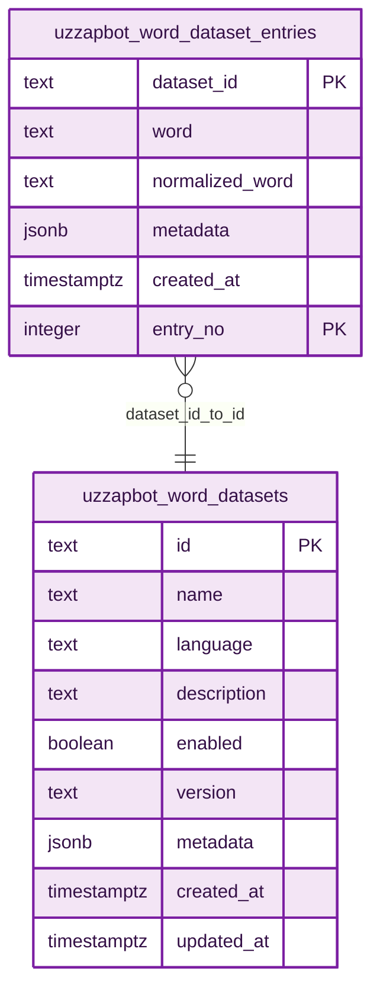

# Uzzap Database Architecture

> **Source:** live Supabase project schema, inspected September 2026.
>
> This document is generated from the current PostgreSQL metadata rather than an older repository SQL snapshot. It documents the public-schema tables, columns, primary keys, foreign keys, and the production UzzapBot data model.

## Uzzap diagram color system

The Mermaid diagrams use a consistent Uzzap visual language:

| Color | Area |
|---|---|
| 🟩 Green | Core Uzzap users, rooms, messaging |
| 🟦 Blue | UzzapBot operations and AI |
| 🟨 Yellow | Games, progression and competitive systems |
| 🟪 Purple | WordHunt datasets |
| 🟥 Red | Moderation and safety |
| ⚪ Gray | Supabase Auth / external infrastructure |

> GitHub Mermaid rendering does not support arbitrary app-wide CSS, so the diagrams use Mermaid `classDef` styling. The colors are diagram-local and may vary slightly with GitHub's rendering/theme.

## Scope

- **Public base tables:** 49
- **Public views:** 1
- **Public RLS:** enabled on every listed base table
- **Foreign-key relationships:** 16 between public tables, plus relationships from public tables to Supabase Auth `auth.users`
- **UzzapBot question rows:** 3,333
- **Word dataset entry rows:** 37,479

The Mermaid ER model below represents the live **database structure**. PostgreSQL functions, triggers, RLS policies, indexes, grants, extensions, and view definitions are database objects that are not fully representable in an ER diagram and should be maintained as SQL/migration documentation separately.

## 1. Core Uzzap schema

```mermaid
erDiagram
    auth_users {
        uuid id PK
    }
    account_deletion_requests {
        bigint id PK
        text email
        timestamptz requested_at
        text status
        timestamptz processed_at
        text notes
    }
    blocked_users {
        bigint id PK
        uuid owner_id
        text blocked_username
        timestamptz created_at
    }
    buddies {
        bigint id PK
        text user_handle
        text buddy_handle
        text group_name
        timestamptz created_at
        uuid owner_id
    }
    buddy_requests {
        bigint id PK
        text requester_handle
        text recipient_handle
        text status
        timestamptz created_at
        timestamptz responded_at
    }
    chat_categories {
        text id PK
        text name
        integer sort_order
    }
    chat_rooms {
        text id PK
        text category_id
        text name
        text topic
        integer capacity
        timestamptz created_at
        boolean is_moderator_only
    }
    direct_messages {
        bigint id PK
        text sender
        text recipient
        text body
        boolean is_read
        timestamptz created_at
        uuid sender_id
        uuid recipient_id
    }
    game_players {
        bigint id PK
        bigint session_id
        uuid user_id
        text username
        text nickname
        integer score
        integer correct
        integer attempts
        timestamptz joined_at
        timestamptz updated_at
        integer clues_used
    }
    game_sessions {
        bigint id PK
        text room_name
        text game
        integer points
        integer limit_count
        boolean paused
        integer question_number
        text question
        text answer
        text clue_text
        jsonb used_questions
        timestamptz started_at
        timestamptz updated_at
        text mode
        boolean endless
        text current_game
        jsonb state_json
        text mode_variant
        integer timer_seconds
        timestamptz deadline_at
        integer survival_lives
        boolean sudden_death
        boolean speed_round
        date daily_challenge_date
    }
    moderation_actions {
        bigint id PK
        uuid moderator_id
        uuid target_user_id
        text target_username
        text action
        text room_name
        bigint message_id
        text reason
        integer duration_minutes
        timestamptz created_at
        text action_type
        timestamptz expires_at
    }
    moderator_roles {
        uuid user_id PK
        text role
        timestamptz created_at
        uuid created_by
    }
    profiles {
        uuid id PK
        text username
        text nickname
        text status
        text status_message
        text avatar
        boolean is_online
        timestamptz last_seen
        timestamptz created_at
        uuid owner_id
        text email
    }
    room_invitations {
        bigint id PK
        text room_name
        uuid inviter_id
        uuid invitee_id
        text inviter_username
        text invitee_username
        text status
        timestamptz created_at
        timestamptz responded_at
    }
    room_messages {
        bigint id PK
        text room_name
        text sender
        text body
        boolean is_system
        timestamptz created_at
        uuid sender_id
    }
    room_participants {
        bigint id PK
        text room_name
        text username
        timestamptz last_ping
        uuid owner_id
    }
    room_sanctions {
        bigint id PK
        uuid user_id
        text username
        text room_name
        text sanction
        timestamptz expires_at
        text reason
        uuid created_by
        timestamptz created_at
        boolean active
    }
    user_fcm_tokens {
        bigint id PK
        uuid user_id
        text username
        text fcm_token
        timestamptz updated_at
    }
    user_reports {
        bigint id PK
        uuid reporter_id
        text reported_username
        text reason
        text details
        timestamptz created_at
        text status
        uuid reviewed_by
        timestamptz reviewed_at
        bigint message_id
        text room_name
    }

    chat_rooms }o--|| chat_categories : category_id_to_id
    game_players }o--|| game_sessions : session_id_to_id
    moderation_actions }o--|| room_messages : message_id_to_id
    user_reports }o--|| room_messages : message_id_to_id

    profiles }o--|| auth_users : owner_id_to_id
    room_messages }o--|| auth_users : sender_id_to_id
    room_participants }o--|| auth_users : owner_id_to_id
    buddies }o--|| auth_users : owner_id_to_id
    direct_messages }o--|| auth_users : sender_id_to_id
    direct_messages }o--|| auth_users : recipient_id_to_id
    blocked_users }o--|| auth_users : owner_id_to_id
    user_reports }o--|| auth_users : reporter_id_to_id
    user_reports }o--|| auth_users : reviewed_by_to_id
    moderator_roles }o--|| auth_users : user_id_to_id
    moderator_roles }o--|| auth_users : created_by_to_id
    moderation_actions }o--|| auth_users : moderator_id_to_id
    moderation_actions }o--|| auth_users : target_user_id_to_id
    room_sanctions }o--|| auth_users : user_id_to_id
    room_sanctions }o--|| auth_users : created_by_to_id
    room_invitations }o--|| auth_users : inviter_id_to_id
    room_invitations }o--|| auth_users : invitee_id_to_id
    user_fcm_tokens }o--|| auth_users : user_id_to_id
    game_players }o--|| auth_users : user_id_to_id

    classDef core fill:#E8F5E9,stroke:#2E7D32,stroke-width:2px,color:#173A1A
    classDef messaging fill:#E3F2FD,stroke:#1976D2,stroke-width:2px,color:#0D2A45
    classDef safety fill:#FFEBEE,stroke:#C62828,stroke-width:2px,color:#4A1515
    classDef games fill:#FFF8E1,stroke:#F9A825,stroke-width:2px,color:#4A3700
    classDef auth fill:#F5F5F5,stroke:#616161,stroke-width:2px,color:#212121

    class profiles,chat_categories,chat_rooms,room_participants,buddies,buddy_requests,blocked_users,account_deletion_requests core
    class room_messages,direct_messages,room_invitations,user_fcm_tokens messaging
    class moderation_actions,moderator_roles,room_sanctions,user_reports safety
    class game_players,game_sessions games
    class auth_users auth
```

## 2. UzzapBot operational and AI schema

```mermaid
erDiagram
    uzzapbot_achievements {
        text id PK
        text name
        text description
        text icon
        integer xp_reward
    }
    uzzapbot_ai_rate_state {
        text room_name PK
        timestamptz window_started_at
        integer request_count
        timestamptz last_request_at
        timestamptz updated_at
    }
    uzzapbot_audit_log {
        bigint id PK
        uuid actor_id
        text action
        text target_type
        text target_id
        jsonb details
        timestamptz created_at
    }
    uzzapbot_control_settings {
        text key PK
        jsonb value
        uuid updated_by
        timestamptz updated_at
    }
    uzzapbot_cursor {
        text bot_name PK
        bigint last_message_id
        timestamptz updated_at
    }
    uzzapbot_event_receipts {
        bigint message_id PK
        timestamptz received_at
        timestamptz processed_at
        text status
        text error_text
        integer attempt_count
        integer retry_count
        integer duplicate_count
        timestamptz last_attempt_at
    }
    uzzapbot_game_config {
        text config_key PK
        jsonb config_value
        text description
        boolean enabled
        timestamptz updated_at
        uuid updated_by
    }
    uzzapbot_game_modes {
        text id PK
        text name
        text description
        boolean enabled
        jsonb config
        timestamptz updated_at
    }
    uzzapbot_game_pools {
        text pool_id PK
        integer position PK
        text game_id
        integer weight
        boolean enabled
        jsonb metadata
        timestamptz created_at
        timestamptz updated_at
    }
    uzzapbot_internal_config {
        text key PK
        text value
        timestamptz updated_at
    }
    uzzapbot_memory {
        bigint id PK
        uuid user_id
        text room_name
        text memory_key
        text memory_value
        text memory_type
        text source
        numeric confidence
        timestamptz created_at
        timestamptz updated_at
    }
    uzzapbot_player_activity {
        bigint id PK
        uuid user_id
        text game
        integer points
        boolean correct
        timestamptz created_at
    }
    uzzapbot_processed_messages {
        bigint message_id PK
        timestamptz claimed_at
        timestamptz completed_at
    }
    uzzapbot_question_usage {
        bigint id PK
        bigint question_id
        text room_name
        text game
        timestamptz used_at
        text outcome
        integer response_ms
    }
    uzzapbot_questions {
        bigint id PK
        text category
        text question
        text answer
        text[] aliases
        integer points
        text difficulty
        text status
        text source
        text verification_notes
        uuid created_by
        uuid reviewed_by
        timestamptz reviewed_at
        timestamptz created_at
        timestamptz updated_at
        integer verification_score
        bigint duplicate_of
        integer usage_count
        timestamptz last_used_at
    }
    uzzapbot_room_activity {
        text room_name PK
        boolean enabled
        integer idle_threshold_seconds
        integer inactive_threshold_seconds
        integer cooldown_seconds
        integer max_messages_per_hour
        integer max_messages_per_day
        timestamptz last_human_activity_at
        timestamptz last_bot_activity_at
        text activity_state
        integer human_message_count_hour
        integer human_message_count_day
        timestamptz updated_at
    }
    uzzapbot_room_settings {
        text room_name PK
        boolean activated
        boolean locked
        boolean wcbot
        text welcome_message
        text challenge_room
        timestamptz updated_at
    }
    uzzapbot_welcomes {
        text room_name PK
        text username_key PK
        timestamptz welcomed_at
    }

    uzzapbot_event_receipts }o--|| room_messages : message_id_to_id
    uzzapbot_question_usage }o--|| uzzapbot_questions : question_id_to_id
    uzzapbot_questions }o--o| uzzapbot_questions : duplicate_of_to_id

    uzzapbot_memory }o--|| auth_users : user_id_to_id
    uzzapbot_player_activity }o--|| auth_users : user_id_to_id
    uzzapbot_questions }o--|| auth_users : created_by_to_id
    uzzapbot_questions }o--|| auth_users : reviewed_by_to_id
    uzzapbot_game_config }o--|| auth_users : updated_by_to_id
    uzzapbot_audit_log }o--|| auth_users : actor_id_to_id

    classDef bot fill:#E3F2FD,stroke:#1565C0,stroke-width:2px,color:#0B2B45
    classDef core fill:#E8F5E9,stroke:#2E7D32,stroke-width:2px,color:#173A1A
    classDef games fill:#FFF8E1,stroke:#F9A825,stroke-width:2px,color:#4A3700
    classDef auth fill:#F5F5F5,stroke:#616161,stroke-width:2px,color:#212121

    class uzzapbot_achievements,uzzapbot_ai_rate_state,uzzapbot_audit_log,uzzapbot_control_settings,uzzapbot_cursor,uzzapbot_event_receipts,uzzapbot_game_config,uzzapbot_game_modes,uzzapbot_game_pools,uzzapbot_internal_config,uzzapbot_memory,uzzapbot_player_activity,uzzapbot_processed_messages,uzzapbot_question_usage,uzzapbot_questions,uzzapbot_room_activity,uzzapbot_room_settings,uzzapbot_welcomes bot
    class room_messages core
    class game_sessions games
    class auth_users auth
```

## 3. UzzapBot progression, challenges and competitive games

```mermaid
erDiagram
    uzzapbot_player_stats {
        uuid user_id PK
        bigint xp
        integer level
        integer current_streak
        integer best_streak
        integer total_games
        integer total_correct
        integer total_attempts
        timestamptz updated_at
        text title_id
    }
    uzzapbot_powerups {
        uuid user_id PK
        text powerup PK
        integer charges
        timestamptz updated_at
    }
    uzzapbot_powerup_uses {
        bigint id PK
        uuid user_id
        text room_name
        bigint session_id
        text powerup
        timestamptz used_at
        timestamptz expires_at
        jsonb metadata
    }
    uzzapbot_xp_history {
        bigint id PK
        uuid user_id
        integer xp_delta
        text reason
        text game
        text room_name
        jsonb metadata
        timestamptz created_at
    }
    uzzapbot_player_achievements {
        uuid user_id PK
        text achievement_id PK
        timestamptz unlocked_at
    }
    uzzapbot_titles {
        text id PK
        text name
        text description
        text achievement_id
    }
    uzzapbot_player_titles {
        uuid user_id PK
        text title_id PK
        timestamptz unlocked_at
    }
    uzzapbot_daily_challenges {
        bigint id PK
        date challenge_date
        uuid user_id
        text room_name
        bigint session_id
        integer score
        integer correct
        integer attempts
        timestamptz completed_at
        timestamptz created_at
    }
    uzzapbot_battles {
        bigint id PK
        uuid challenger_id
        uuid challenged_id
        text room_name
        text status
        bigint session_id
        uuid winner_id
        timestamptz created_at
        timestamptz accepted_at
        timestamptz completed_at
    }
    uzzapbot_room_challenges {
        bigint id PK
        text room_name
        uuid creator_id
        bigint session_id
        text status
        timestamptz created_at
        timestamptz completed_at
    }
    uzzapbot_tournaments {
        bigint id PK
        text room_name
        uuid creator_id
        bigint session_id
        text status
        integer rounds
        integer current_round
        uuid winner_id
        timestamptz created_at
        timestamptz started_at
        timestamptz completed_at
    }

    uzzapbot_player_stats }o--|| uzzapbot_titles : title_id_to_id
    uzzapbot_player_achievements }o--|| uzzapbot_achievements : achievement_id_to_id
    uzzapbot_player_titles }o--|| uzzapbot_titles : title_id_to_id
    uzzapbot_titles }o--|| uzzapbot_achievements : achievement_id_to_id
    uzzapbot_powerup_uses }o--|| game_sessions : session_id_to_id
    uzzapbot_daily_challenges }o--|| game_sessions : session_id_to_id
    uzzapbot_battles }o--|| game_sessions : session_id_to_id
    uzzapbot_room_challenges }o--|| game_sessions : session_id_to_id
    uzzapbot_tournaments }o--|| game_sessions : session_id_to_id

    uzzapbot_player_stats }o--|| auth_users : user_id_to_id
    uzzapbot_player_achievements }o--|| auth_users : user_id_to_id
    uzzapbot_player_titles }o--|| auth_users : user_id_to_id
    uzzapbot_powerups }o--|| auth_users : user_id_to_id
    uzzapbot_powerup_uses }o--|| auth_users : user_id_to_id
    uzzapbot_xp_history }o--|| auth_users : user_id_to_id
    uzzapbot_daily_challenges }o--|| auth_users : user_id_to_id
    uzzapbot_battles }o--|| auth_users : challenger_id_to_id
    uzzapbot_battles }o--|| auth_users : challenged_id_to_id
    uzzapbot_battles }o--|| auth_users : winner_id_to_id
    uzzapbot_room_challenges }o--|| auth_users : creator_id_to_id
    uzzapbot_tournaments }o--|| auth_users : creator_id_to_id
    uzzapbot_tournaments }o--|| auth_users : winner_id_to_id

    classDef games fill:#FFF8E1,stroke:#F9A825,stroke-width:2px,color:#4A3700
    classDef bot fill:#E3F2FD,stroke:#1565C0,stroke-width:2px,color:#0B2B45
    classDef auth fill:#F5F5F5,stroke:#616161,stroke-width:2px,color:#212121

    class uzzapbot_player_stats,uzzapbot_powerups,uzzapbot_powerup_uses,uzzapbot_xp_history,uzzapbot_player_achievements,uzzapbot_titles,uzzapbot_player_titles,uzzapbot_daily_challenges,uzzapbot_battles,uzzapbot_room_challenges,uzzapbot_tournaments games
    class game_sessions bot
    class auth_users auth
```

## 4. WordHunt data model

## 5. View

The live public schema also contains:

- `uzzapbot_performance_24h` — VIEW
  - `processed bigint`
  - `failed bigint`
  - `avg_latency_ms numeric`
  - `p95_latency_ms numeric`
  - `last_processed_at timestamptz`

## 6. Live table inventory

| Area | Tables |
|---|---|
| Core Uzzap | 18 |
| UzzapBot operations/AI | 18 |
| UzzapBot progression/competitive | 11 |
| WordHunt | 2 |
| **Total base tables** | **49** |
| Views | 1 |

> The inventory count above is based on the live Supabase metadata. The ER diagrams intentionally group related tables for readability. Live public-object counts at inspection time: **81 functions, 54 RLS policies, 18 non-internal triggers, and 122 indexes**.

## 7. Important schema observations

1. The live database contains **49 public base tables**, which is newer/larger than the older repository description that referenced a 15-table baseline.
2. `uzzapbot_questions` currently contains **3,333 questions**, matching the current game dataset.
3. `uzzapbot_word_dataset_entries` currently contains **37,479 entries**.
4. `uzzapbot_memory` is a real persistent user-memory table with typed memory and confidence fields.
5. `uzzapbot_event_receipts` is linked directly to `room_messages`, supporting the message → bot receipt/processing architecture.
6. `uzzapbot_questions.duplicate_of` is self-referential, allowing duplicate questions to point to their canonical question.
7. `uzzapbot_performance_24h` is a **view**, not a base table.
8. Many user-related foreign keys point directly to Supabase-managed `auth.users`; that table is outside the `public` schema and is represented here as the external `auth_users` entity.

## 8. What this document does not replace

This is the **live database ER architecture**, not a replacement for the complete executable SQL schema dump. The live public schema currently has **49 base tables + 1 view**; the older repository baseline description should therefore be treated as stale.

For a truly reproducible database baseline, the repository should also retain/generated:

- table DDL
- constraints and checks
- indexes
- RLS enablement
- RLS policies
- PostgreSQL functions/RPCs
- triggers
- grants
- views and view definitions
- extensions
- migration history

Those objects should be compared against the live project before calling the repository SQL a complete production backup.
